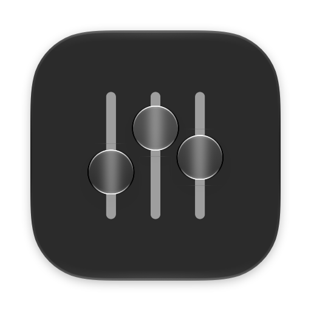
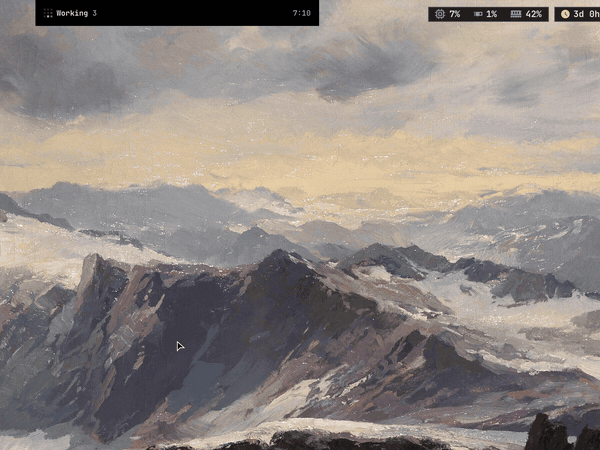

<p align="center">
  
</p>

<h1 align="center">Tone</h1>

<p align="center">Per-app volume and EQ, right in your menu bar.</p>

<p align="center">
  
</p>

<p align="center"><a href="docs/demo.mp4">Watch the full-quality video</a></p>

Tone is a menu bar app that lets you mix and shape audio per app. Click the icon and you'll see every app making sound, plus your output and input devices and what's currently playing.

You can set each app's volume anywhere from 0 to 200%, and give it its own 10-band EQ with presets. Switch outputs and inputs, connect paired Bluetooth headphones, and check your AirPods battery before you connect them. You can also change AirPods Listening Mode and Conversation Awareness, and play, pause or skip whatever's playing.

There's no drivers or kernel extensions, instead Tone just uses what macOS provides.

## Requirements

- macOS 15 or later, tested on macOS 27

## Install

1. Download `Tone.dmg` from the [latest release](https://github.com/Sowyu/Tone/releases/latest).
2. Open it and drag Tone into Applications.
3. Open Tone from Applications. macOS will say it can't check Tone for malware, because Tone isn't notarized by Apple, so click Done.
4. Go to System Settings > Privacy & Security, scroll down and click Open Anyway next to the message about Tone, then confirm.

You only have to do that once, and after that Tone updates itself from inside the app.

## Permissions

The first time you change a volume or EQ, macOS asks to allow system audio recording. The audio never leaves your Mac. Tone also asks for Bluetooth access so it can read battery levels and control AirPods.

## Build from source

```
brew install xcodegen
make identity
make install
```

The local signing certificate is what lets macOS remember Tone's permissions across rebuilds.

## Updates

Tone checks GitHub for a new release once a day, and you can check yourself from Settings. It only installs when you click Install Update. Before swapping anything in, it checks the download's SHA-256 against GitHub and makes sure the new app is signed with the same certificate as the one you have. If the new version doesn't start, your old copy comes back.

## Making a release

1. Bump `MARKETING_VERSION` and `CURRENT_PROJECT_VERSION` in `project.yml`, then commit and push to main
2. Write the release notes in `build/notes.md`
3. Run `make release NOTES=build/notes.md DRY_RUN=1` to build and check `build/Tone.dmg` without publishing
4. Run `make release NOTES=build/notes.md` to publish it as release `v<version>` on GitHub

The release has to be signed with the same "Tone Local Signing" certificate every time, or Tone won't accept the update.

## Credits

The design is based on Jace's sound mixer concept ([JaceThings on X](https://x.com/JaceThings/status/2105247096916099505)). Tone isn't affiliated with Jace.

Now Playing uses [mediaremote-adapter](https://github.com/ungive/mediaremote-adapter) by Jonas van den Berg, bundled under the BSD 3-Clause License.

## Known limitations

- Spatial Audio isn't available
- Battery for non-Apple headphones only shows while connected

## License

[MIT](LICENSE)