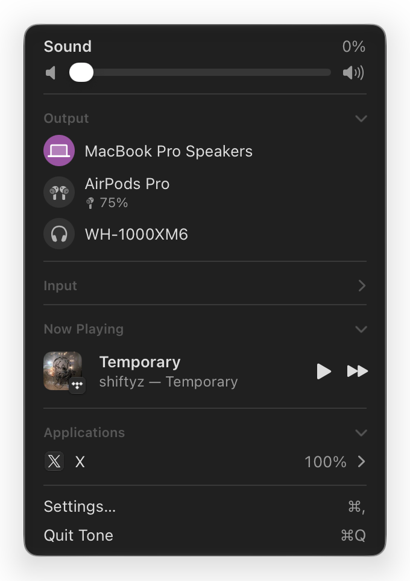

<p align="center">
  
</p>

<h1 align="center">Tone</h1>

<p align="center">Per-app volume and EQ, right from the menu bar.</p>

<p align="center">
  
</p>

Tone lives in your menu bar. Click it to see every app making sound, adjust each one independently, and control your output, input, and Now Playing.

- Set each app's volume from 0 to 200%.
- Apply a 10-band EQ to any app, with presets.
- Switch output and input devices. Connect paired Bluetooth headphones with one click.
- See AirPods battery before they connect. Change Listening Mode and Conversation Awareness.
- Play, pause, and skip what's playing.
- Adjust the main output volume.

No drivers. No kernel extensions. Tone uses only what macOS already provides.

## Requirements

- macOS 15 or later. Tested on macOS 27.
- Optional: `brew install media-control` for Now Playing support.

## Permissions

The first time you change volume or EQ, macOS asks to allow system audio recording. Audio never leaves your Mac. Bluetooth permission is needed for battery info and AirPods controls.

## Build from source

```
brew install xcodegen
make identity   # once
make install
```

A stable local signing identity keeps macOS from forgetting permissions between builds.

## Credits

Design based on Jace's sound mixer concept (JaceThings on X): https://x.com/JaceThings/status/2105247096916099505. Tone is independent and not affiliated.

## Known limits

- Now Playing needs media-control installed.
- Spatial Audio is not available.
- Battery for non-Apple headphones only shows while connected.

## License

MIT. See [LICENSE](LICENSE).